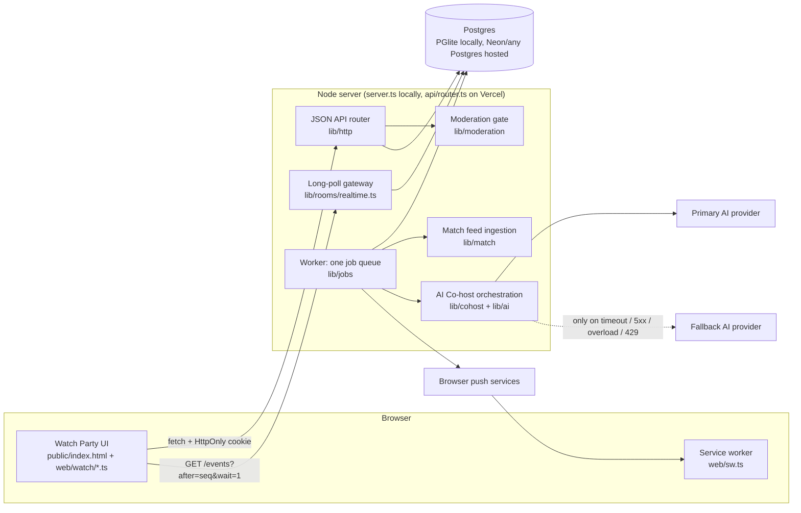
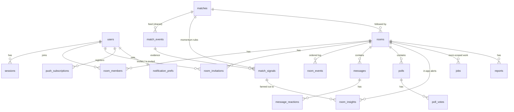

# Huddle Watch Party: architecture

Huddle is a sports Watch Party prototype for cricket, Formula 1, basketball and ice hockey: friends (or the public)
chat in a room while a game plays, the room shows verified match data, and an AI Co-host answers questions (about the
rules and the players too), flags big moments and catches people up. It is one
Node.js application written in TypeScript, with one Postgres database. There is no video, no microservice split, no
Redis and no broker.

**Status labels used below:** **Implemented** (built and covered by tests), **Simulated** (demo data, labelled in
the UI), **Planned** (not built).

| Capability | Status |
|---|---|
| Joining (one tap: a guest profile with a username Huddle picks), sessions | Implemented. No name, phone number or password: a 30-day HttpOnly session cookie keeps the browser signed in; new profiles are limited per network |
| Public and private Watch Party rooms, invitations, roles, presence | Implemented; six labelled **demo friends** can be invited to try invitations alone |
| Realtime chat, reactions, polls (long-polling) | Implemented |
| Moment threads: #topics for big moments and for what the room argues about | Implemented (deterministic rules) |
| Match Intelligence for four sports: a scoreboard per sport, play by play, status, freshness | Implemented on **simulated** feeds (real names, made-up games): MI v CSK, the Italian Grand Prix, Warriors v Lakers, Oilers v Maple Leafs; one shared game and public watch party per sport |
| A private room's own replay with host controls (start, pause, 0.5x / 1x / 2x, restart, jump) | Implemented (simulated replay only); demo games play at 0.5x by default |
| Simulated fans: 200 per sport, chatting in that sport's public watch party only | **Simulated** (derived on request, never stored, not sent to the AI) |
| Rules and players help: a checked rules sheet and roster per sport; questions answered from the game as it stood when they were asked | Implemented; live answers need an AI key |
| Match Momentum Engine (deterministic rules, dedup, fan-out) | Implemented |
| AI Co-host: Q&A, unanswered questions, quiet-room polls, momentum explanations, Catch Me Up | Implemented; live AI needs an API key (provider calls are tested with mocked HTTP) |
| Primary/fallback AI providers, circuit breaker | Implemented (Anthropic, OpenRouter, Gemini and xAI Grok adapters; OpenRouter and Grok share one chat-completions adapter) |
| Moderation levels, public policy, mandatory baseline, reports, review queue, appeals | Implemented |
| In-app alerts; browser push for away members | In-app implemented; push implemented with VAPID and tested against a mocked push service |
| Ephemeral rooms (end, revoke, purge after retention) | Implemented |
| Real sports data providers, account recovery, user blocking, quiet hours, async AI moderation | Planned |

## 1. System overview



- **One backend.** `server.ts` serves the static UI, the API and runs the worker loop in-process. On Vercel the same
  router runs as one function (`api/router.ts`), and long-poll requests run due jobs while they wait.
- **One database.** Postgres SQL everywhere. Locally the server embeds **PGlite** (Postgres compiled to WebAssembly),
  so `npm start` needs no setup. With `DATABASE_URL` set it uses node-postgres against any Postgres (e.g. Neon).
- **Realtime = long-polling.** Every visible change in a room gets the next per-room sequence number in `room_events`.
  Clients poll `GET /api/rooms/:id/events?after=<seq>&wait=1`; the server answers as soon as something newer exists
  (in-process wake-up locally, a 1-second database check across instances). Each poll re-authorises the caller, so
  leaving, removal and room closure cut the stream off immediately.
- **One job queue** (`jobs` table) for everything slow: AI answers, quiet-room checks, momentum explanations, polls
  closing, push delivery, room auto-end and purge. Chat delivery never waits for it.

## 2. Where the data lives

| Data | Where | Retention |
|---|---|---|
| All application data (tables in §3) | Local: `.data/pglite/` (embedded Postgres files, git-ignored). Hosted: the Postgres in `DATABASE_URL` | Per table, §3 |
| Server secret for HMACs | `HUDDLE_SECRET`; locally generated once into `.data/dev-secret` | Until rotated |
| Browser push keys (VAPID) | `VAPID_*` env; locally generated into `.data/vapid.json` | Until rotated |
| AI provider keys | Server environment only (`ANTHROPIC_API_KEY`, `OPENROUTER_API_KEY`, `GEMINI_API_KEY`). Never in the browser, logs or job payloads | n/a |
| Session | Browser: random token in an `HttpOnly; SameSite=Lax` cookie. Server: only its SHA-256 hash in `sessions` | 30 days |
| Push subscription | Browser push service + `push_subscriptions` (endpoint and keys) | Until removed or the endpoint returns 404/410 |
| Match feed | `match_events` / `match_signals`, shared by every room that follows the match | Kept with the match (demo data) |
| Data sent to AI providers | Per request only: verified match facts, a bounded window of this room's messages with members pseudonymised (`member1`…), the question. Never handles, other rooms or secrets | Subject to each provider's own terms |
| Logs | stdout JSON lines: ids, categories, timings. Message text, tokens and keys are redacted (`lib/log.ts`) | Hosting log retention |
| Hosted database backups | The Postgres provider's backups / point-in-time restore | Follow the provider's window. Huddle's purge does not reach backups, so deletion there is not immediate |

## 3. Database schema

Defined in `lib/db/migrations/001_watch_party.sql` and applied automatically at start-up (additive migrations,
advisory-locked so two instances never race). IDs are prefixed random strings (`usr_…`, `room_…`, `msg_…`).



### Identity and access
| Table | Purpose | Key columns |
|---|---|---|
| `users` | One row per profile | `handle` (the username: unique, public), `display_name` (no longer written or read), `sports` (per sport: the team backed or null, and up to 3 players, migration `010`); `is_demo` (the labelled demo friends, migration `005`). Migration `011` dropped the old `team`, `picks` and `phone_e164` columns |
| `sessions` | Server-side sessions | `token_hash` (SHA-256 of the cookie token), `expires_at`, `revoked_at` |

### Match Intelligence (shared across rooms; never per room)
| Table | Purpose | Key columns |
|---|---|---|
| `matches` | One match run | `source` = `demo_fixture`, `fixture_key` (which sport's script: `mi-csk-demo`, `f1-monza-demo`, `nba-gsw-lal-demo`, `nhl-edm-tor-demo`), `status` scheduled/live/completed, `feed_started_at`, `ball_interval_ms`, `backfill_until` (demo jumps); `room_id` (set only for a private room's own replay run, migration `006`), `paused_at` |
| `match_events` | Timestamped feed events | `provider_event_id` (unique per match: dedupes re-ingestion), `seq`, `kind` ball/event/overend, `data` (bowler, batter, runs, wicket…), `occurred_at`, `backfilled` |
| `match_signals` | Momentum Engine output, one per crucial moment | `trigger` (e.g. `wicket_fallen`), `priority` high/medium/low, `evidence` (verified facts), `fact_text` (deterministic sentence), `dedupe_key` (unique), `status` pending/published/suppressed/expired, `ai_text` (optional validated explanation), `expires_at` |

The scoreboard is not stored: each sport's engine (`lib/match/sports/`) recomputes it deterministically from
`match_events` (cricket: runs, wickets, overs, required rate, batting and bowling cards, fall of wickets, partnership;
F1: the running order, gaps, tyres and pit stops; basketball and hockey: the score, clock and key stats), and it is
cached in memory per match. `lib/match/fixture.ts` lists the four fixtures; each brings its engine, crowd, discussion
topics, rules sheet, roster and example questions.

### Rooms and membership
| Table | Purpose | Key columns |
|---|---|---|
| `rooms` | Watch parties | `room_type` public/private, `creator_id` (required for private), `match_id`, `moderation_level` (private only; a CHECK forbids storing one on public rooms), `status` active/ended/purged, `last_seq` (per-room sequence), `ai_enabled`, `ended_at`, `purge_after` |
| `room_members` | Membership and roles | PK `(room_id, user_id)`, `role` owner/admin/member (at most one owner per room, unique index), `status` active/left/removed |
| `room_invitations` | Invitations | `inviter_id`, `invitee_id`, `status` pending/accepted/declined/expired/revoked, `expires_at` (48 h); at most one pending invite per person per room |
| `room_presence` | Who is in the room now | `last_seen_at` (refreshed by polls), `state` active/inactive (tab visible or hidden) |

### Room content: ephemeral
| Table | Purpose | Key columns |
|---|---|---|
| `room_events` | Realtime outbox: what changed, in order | PK `(room_id, seq)`, `type` message/message_update/poll/insight/member/room, `entity_id`. Ids only, no text |
| `messages` | Chat and AI Co-host replies | `sender_type` user/ai (AI messages have no sender and a distinct type so the AI can never trigger itself), `client_msg_id` (idempotency key, unique per sender), `body`, `reply_to_id`, `status` visible/held/removed, `answer_state` (pending → human / ai_claimed → ai_answered / ai_unavailable / cancelled), `ai_meta` (provider, model, grounding, `asked_at`; never the prompt), `moderation` (decision summary; never a copy of the text), `thread_id` (migration `008`), `match_seq` (the newest play when it was sent, migration `009`) |
| `room_threads` | A #thread inside a room | `slug` (unique per room), `title` (#slug), `about`, `keywords`, `source` moment/discussion, `last_active_at`. Room content: purged with the messages |
| `message_reactions` | Allowlisted emoji reactions | PK `(message_id, user_id, emoji)` |
| `polls`, `poll_votes` | AI or template polls | `idempotency_key` (unique), one open poll per room, `closes_at` |
| `room_insights` | In-app delivery of a match signal to one room | unique `(room_id, signal_id)`: a retry can never show the same alert twice |

When a room ends, every user-facing read of this content stops at once. The purge job deletes all of it
`MESSAGE_RETENTION_HOURS` later (default 24 h) and nulls the room name; a sweep re-queues any purge that was missed.

### Limits
| Table | Purpose |
|---|---|
| `user_send_cooldowns` | One row per user: `next_allowed_at`. The chat rule (one message every 10 s, `CHAT_COOLDOWN_SECONDS`) is one atomic `INSERT … ON CONFLICT DO UPDATE … WHERE next_allowed_at <= now()` |
| `rate_events` | Sliding-window counters for new profiles per network, AI requests, reactions and search (advisory-locked per bucket). Deleted after 2 h |

### Moderation (minimal audit, no message text)
| Table | Purpose |
|---|---|
| `moderation_events` | Every automated or human decision: categories, severity, `policy_version`, level, action. Retained 30 days |
| `reports` | Member reports (message or AI response) and appeals; status open/dismissed/actioned |

### Background work, AI observability, notifications
| Table | Purpose |
|---|---|
| `jobs` | The one queue: `type`, `room_id`, `dedupe_key` (unique), `payload` (ids and deadlines only), `priority`, `status` queued/running/done/dead/cancelled, `run_at`, `expires_at`, `attempts`/`max_attempts`, `locked_until` |
| `ai_calls` | One row per provider attempt: task, provider, model, outcome, error category, fallback reason, latency, tokens. No prompts or transcripts. Retained 7 days |
| `notification_prefs` | Per-user push choices (momentum on, answers off, invites on by default) |
| `push_subscriptions` | Browser push endpoints and keys |
| `notification_deliveries` | Delivery metadata only: `dedupe_key` (source event + recipient), kind, priority, status, `expires_at`. No notification text, no inbox. Deleted after 24 h |

## 4. Workflows

### 4.1 Joining
1. A new visitor taps Join: `POST /api/auth/guest {}`. The server picks a unique username (`fan_` and four digits,
   one more digit after each clash). Usernames chosen later in Edit profile pass the same strict safety check as other
   public labels, are unique, and reserved names (huddle, admin, moderator…) are refused.
2. The server creates the profile and a session. The browser holds a random token in an HttpOnly, SameSite=Lax
   cookie (`__Host-` prefixed and Secure in production); the database keeps only its SHA-256 hash. Sessions last
   30 days. There is no password, so a profile cannot be recovered after signing out or clearing the browser.
3. New profiles are limited per network (`GUEST_SIGNUPS_PER_IP_PER_HOUR`, default 10), so nobody can mint accounts
   to get around the one-message-every-10-seconds rule. Without `HUDDLE_SECRET` joining fails closed.
4. Platform moderators are listed by account id (`MODERATOR_USER_IDS`). Ids are random and server-generated, so
   nobody can claim moderator rights by choosing a name.

### 4.2 Private room and invitations
`POST /api/rooms` creates the room, makes the caller its owner, records the chosen level (`relaxed`/`balanced`/`strict`)
and invites up to 10 people found through handle search. Invitees see the invitation on their home
screen (and as a generic push if they opted in). Accepting checks that the invitation belongs to the caller, is still
pending, unexpired, the room is active and not full. Owners promote members to admin; nobody can change their own role.

To try invitations without a second person, six demo friends are created once, the first time anyone loads
`GET /api/rooms`: handles `demo_aarav`, `demo_diya`, `demo_kabir`, `demo_meera`, `demo_rohan` and `demo_sana`, names
ending in "(demo)", `users.is_demo = true`. The invite picker offers them while its search box is empty
(`GET /api/users/demo`) and search marks them `demo: true`. They never get a session and nobody can join with a
`demo_` handle, so their invitations stay pending until revoked or expired. `DEMO_USERS=false` stops offering them.

### 4.3 Sending a message (fast path)
```mermaid
sequenceDiagram
  participant C as Client
  participant API as API
  participant DB as Postgres
  participant O as Other members (long-poll)
  C->>API: POST /rooms/:id/messages {client_msg_id, text}
  API->>DB: session, membership, room active
  API->>DB: same client_msg_id already stored? return it
  API->>API: safety gate (lib/moderation/classifier.ts)
  alt rejected
    API-->>C: 422 + reason (no row, no cooldown used, audit row only)
  else allowed / flagged / held
    API->>DB: BEGIN; 10 s limiter CAS; next room seq; insert message; room_events; follow-up jobs; COMMIT
    API-->>C: 201 message + cooldown_until
    DB-->>O: next poll (or in-process wake-up) returns the event
  end
```
Held messages (uncertain high-risk text) are stored without a sequence number and are visible only to the sender and
moderators until reviewed. AI work is only queued here: no LLM call ever sits on this path.

### 4.4 Match Momentum
1. The worker advances every live match feed once per tick. Due items are inserted into `match_events` (deduped by
   provider event id) inside a per-match row lock.
2. The deterministic rules in `lib/match/momentum.ts` compare the scorecard before and after each item: wickets
   (`partnership_break` when a 30+ stand ends), dropped catches, boundary bursts, dot-ball pressure, a required-rate
   spike, death overs, DRS outcomes and the confirmed result. Thresholds are documented demo heuristics. The F1,
   basketball and hockey scripts mark their moments on the items themselves (pit stops, safety car, lead changes,
   clutch time, the buzzer-beater, power plays, goals, the empty net, the result), and `lib/match/sports/scripted.ts`
   turns them into the same signal rows.
3. Only fresh signals alert. A backlog (server asleep), a demo jump (backfill) or several signals in one pass publish
   at most one alert; the rest are stored as `suppressed` for Catch Me Up.
4. A `momentum_signal` job asks the AI Co-host for one explanatory sentence, validates it (schema, cited event ids,
   every number must exist in the verified data, strict safety), and publishes with a compare-and-set. Without AI, the
   deterministic `fact_text` is published on its own.
5. Fan-out: one `room_insights` row per active room following the match → every eligible member sees it in the room
   feed; high and medium priority also show as an in-app toast.
6. Notifications: high and medium priority moments (wickets, partnership breaks, dropped catches, run-rate spikes,
   the result) go to opted-in members with a push subscription who are **not looking at the room** (tab hidden or
   closed; people watching the room get the in-app pop-up instead). Each person gets at most
   `MATCH_ALERTS_PER_USER` (default 8) per match, at least 90 s apart, with the last slot kept for the result.
   For a private room's own replay, every run of that room in the last 12 hours counts as one match, so restarting
   it never resets the cap.
   Low-priority moments (boundary bursts, dot balls, death overs, DRS) stay in-app only. Deliveries are deduped per
   signal and person; just before sending, the job re-checks room, membership, preference, expiry and whether the
   person has come back. The payload is verified match facts only: no room name, no chat text.

### 4.5 AI Co-host answers
- `@huddle …` queues an `ai_answer` job immediately. A question about the room's sport (a question mark or question
  word, and one of that sport's terms) without a mention queues one with a delay
  (`UNANSWERED_QUESTION_DELAY_SECONDS`, default 25 s).
- A human reply (`reply_to`, or an `@handle` mention of the asker) flips the question's `answer_state` from `pending`
  to `human`. The job claims the question with the same compare-and-set (`pending` → `ai_claimed`), so only one path
  can win.
- The job builds the context on the server: verified facts and commentary with timestamps, plus the last 12 messages
  of that room only, pseudonymised and labelled untrusted. It calls the orchestrator, validates the output, then
  publishes in a transaction that requires the room to still be active. An answer that fails validation, or a room
  that ended mid-generation, publishes nothing.
- Rule and player questions are answered at the moment they were asked. Each message stores `match_seq`, the newest
  play when it was sent; the job rebuilds the game as it stood then (`stateAt`) and sends it as MATCH_WHEN_ASKED,
  with the sport's checked RULES_SHEET and ROSTER. The validator accepts numbers only from the match facts, the rules
  sheet or the roster, so an invented figure is rejected. An answer from the rules sheet carries
  `grounding.status = rules_sheet`, and `ai_meta.asked_at` names the over or game clock it was asked at.
  `GET /api/rooms/:id/guide` shows newcomers the same sheet, roster and example questions.

### 4.6 Catch Me Up
`POST /api/rooms/:id/catchup {since_seq}` checks membership and room state, gathers this room's messages since that
point (max 40), the match events and key moments since then, and polls. It returns either an AI summary (validated) or a
deterministic summary from verified data. It goes to the requester only; nothing is written to the chat.

### 4.7 Quiet rooms
Each human message reschedules a `continuity_check` job for the room 3 minutes later. If the room is still quiet,
someone is online, the match is live and no poll was posted in the last 10 minutes, the Co-host posts one light poll
(AI, or a deterministic "Who wins from here?" template when no AI is configured).

### 4.8 Room end and purge
```mermaid
sequenceDiagram
  participant Owner
  participant API
  participant DB
  Owner->>API: POST /rooms/:id/end (owner; moderators for public rooms; or match finished + 10 min)
  API->>DB: UPDATE rooms SET status='ended' WHERE status='active' (atomic)
  API->>DB: cancel room jobs, expire invites and queued alerts, clear presence, queue purge at +24 h
  API->>API: clear room-scoped AI context cache, wake pollers (they get status 'ended', no history)
  Note over DB: 24 h later
  DB->>DB: room_purge job deletes messages, reactions, polls, insights, room_events; room.status='purged', name=NULL
```

### 4.9 AI provider failover
`lib/ai/orchestrator.ts` runs every task with one overall deadline (16 s; 8–14 s for momentum and catch-up):
- Primary first. Retryable failures are timeout, 5xx, overload and 429. A 5xx, or a 429 with a short `Retry-After`,
  gets one retry; then the fallback is tried within the remaining deadline.
- Safety refusals, invalid requests, auth errors, malformed output and validation failures never switch providers.
- A per-provider circuit breaker opens after 3 consecutive failures for 30 s, then lets a single probe through.
- Concurrency is capped (3), and per-user (6 per 5 min) and per-room (30 per 10 min) AI budgets apply.
- If both providers fail, the Co-host degrades: chat, reactions, polls and match data keep working.

### 4.10 A private room's own replay
The public watch party, and private rooms that follow the shared replay, all see one match run (fan-out above), so
nobody can pause or move it. A private room created with `own_replay: true` gets its own run of the same script
(`matches.room_id` = the room) and waits for its host. Its owner and admins use `POST /api/rooms/:id/replay`:
- **Start** sets the run live. **Pause** stores `paused_at`, and ingestion skips paused runs; **Resume** moves
  `feed_started_at` on by the pause, so no ball is skipped.
- **Speed** (0.5x, 1x or 2x) changes `ball_interval_ms` and re-anchors the clock on the last ingested ball. Shared
  games and new runs start at `DEMO_SPEED` (0.5x by default).
- **Jump** ahead backfills the skipped balls (no alerts). Jumping back, or **Restart**, creates a fresh run in one
  transaction: the room moves to it and the old run is closed. Restarts are limited to 6 per room per hour, an
  auto-end queued for an old run is ignored once the room has moved on, and the alert cap spans the room's runs.
- Every control wakes the room's long-polls; `match_rev` includes the run, pause state and pace, so every member's
  screen updates at once. The DEMO_CONTROLS jump for the shared replay refuses private runs.

### 4.11 Simulated fans
Public watch parties get a scripted crowd: labelled demo data, derived rather than stored (a private room holds only
the people invited). Each sport has 200
simulated fans (`lib/match/fans.ts`: seeded handles split between the two sides, such as MCL and RBR fans
for F1); the bootstrap lists them as `simulated_fans`, and the room header counts real people online and the
simulated fans separately. `GET /api/rooms/:id/match` returns `crowd`, the lines for the plays of the last 45 s,
built by `lib/match/crowd.ts` from each play's crowd cue in the sport's script (or background chatter) with a random
generator seeded by room, run and play. So everyone in a room sees the same fans say the same thing, another room gets a different
crowd, balls skipped by a jump get none, and 2x halves the gaps. Each line carries `at` (ball time plus its place in
the burst) and the client shows it then, marked "Simulated fan"; overdue lines (opening the room late) are skipped.
Lines the room's moderation level would not allow are dropped, and nothing is written to `messages`, so the crowd
never reaches the AI Co-host, the message rate limit, reports or retention. Each viewer can hide it on their device.

### 4.12 Moment threads
A room splits its chat into #threads without anyone managing them (`lib/rooms/threads.ts`):
- **Big moments** open one in every room following the match, inside feed ingestion: in cricket a wicket
  (`#dube-out`), the bowling change, the DRS call, a dropped catch, the last over; in F1 the pit wall, the safety car,
  Norris v Verstappen and the last lap; in basketball Curry's threes, clutch time and the buzzer-beater; in hockey the
  power play, each goal and the empty net; and every result. Cricket's are ordinary cricket events, so a real feed
  would open the same threads; the other sports mark them on the scripted items. Plays skipped by a jump open none,
  and re-ingesting opens nothing twice.
- **Discussions** open one when three messages from at least two people in ten minutes argue about the same topic
  of the room's sport (in cricket, Hinglish and English keywords for the DRS call, a dropped catch, the bowling
  change, the last over; in F1 the safety car, the pit wall, the stewards; in basketball the refs and the threes; in
  hockey the refs and the goalies); those messages move into it.
- A message joins the thread it is sent from (`thread_id`), else one whose topic it mentions, else a big moment
  from the last 30 s. Every message still shows in All chat. AI answers stay in their question's thread, and the
  simulated fans' reactions to a moment carry its thread.
- New threads reach clients as `thread` events; the chips above the chat filter it and show counts.

## 5. Security and privacy controls
- **Authorization on every request**: the user comes from the session; room access is checked in one place
  (`roomAccess`). Private rooms return 404 to non-members, the same answer as a missing room. Room type, roles and
  moderation level are read from the database, never from the request; unknown request fields are rejected.
- **Room isolation**: every query is scoped by room id after the membership check. AI context and caches are keyed by
  room and cleared when the room ends.
- **Prompt injection**: system instructions are server-owned; room text, names and commentary travel as labelled JSON
  data. The model has no tools, so it cannot read other rooms, change settings or act on anyone.
- **Input**: text only (multipart and attachments are refused with 415/400), 500-character limit, Unicode
  normalisation, invisible and bidi characters stripped, rendered with `textContent` only. CSP is `script-src 'self'`.
- **Moderation**: the baseline (threats, self-harm encouragement, hate slurs, sexual harassment, personal data) is
  enforced at every level and in every room type. Levels only tune profanity, insults and spam. Three stopped
  messages within ten minutes pause posting for two minutes; nobody is banned automatically. Members can report,
  three reports hide a message for human review, and appeals are possible.
- **Secrets** stay in server env vars; logs are redacted; `ai_calls` stores no prompts.
- **Transport and headers**: in production the session cookie is `__Host-` prefixed (Secure, host-only), HSTS is on,
  and the CSP allows scripts, connections and frames from this site only.
- **Room size**: public watch parties hold up to `PUBLIC_ROOM_MAX_MEMBERS` (100); private rooms up to 50 with invites.

## 6. Reliability guarantees (and what is not promised)
- Chat ordering: a concurrency-safe per-room sequence (`UPDATE rooms SET last_seq = last_seq + 1 … RETURNING`).
- Delivery: at-least-once; clients dedupe by sequence and entity id. No exactly-once promise.
- Idempotency: `client_msg_id` for messages, unique `dedupe_key` for jobs, signals and deliveries, unique
  `(room_id, signal_id)` for insights, a derived key for AI answers, and `idempotency_key` for polls.
- Jobs: durable (same transaction as the triggering write), retried with exponential backoff and jitter, dead-lettered
  after `max_attempts`, re-check room and membership when they run, and expire instead of delivering late.
- Measured with `node scripts/load-check.ts` on one laptop (single server, embedded PGlite, 3 rooms × 10 members,
  everyone long-polling): a burst of 30 simultaneous messages reached all 270 recipients with no loss, duplicates or
  reordering, p95 send-to-delivery 0.85 s (the embedded database runs queries one at a time, so bursts queue).
  Messages sent while three 4-second AI calls were in flight arrived in p95 0.27 s, so slow AI work does not hold up
  chat. These are prototype numbers from one machine, not capacity claims; nothing was designed for large-scale traffic.

## 7. Known limitations
- Every game is a scripted replay labelled as simulated. A licensed provider per sport would replace the fixtures in
  `lib/match/sports/`; the F1, basketball and hockey moments are marked in the scripts, so a real feed for those
  sports would also need momentum rules like cricket's. The rules sheets are short hand-written summaries, not the
  official rulebooks.
- Joining is a guest profile without phone verification: one person can hold several profiles (limited per
  network per hour), and a profile cannot be recovered once its browser session is gone.
- Authorization is enforced in application code, not Postgres Row Level Security (one server role connects).
- On serverless hosting, background jobs run while some member is connected (long-poll requests drive them), plus
  a daily Vercel Cron sweep. A dedicated worker process would remove that dependency.
- Circuit-breaker state and the AI concurrency cap are per server instance.
- Live AI providers were not exercised end to end in this environment (no API keys); adapters are tested with mocked
  HTTP and the SDK's typed errors.
- Browser push was exercised with a mocked push service, not on a real device.
- Types are checked at compile time only: query results are trusted to match the row types in `lib/db/rows.ts`
  (nothing validates them at runtime), and `any` remains at the edges where data is not modelled (raw request JSON
  before validation, vendor JSON, some per-sport script data).
