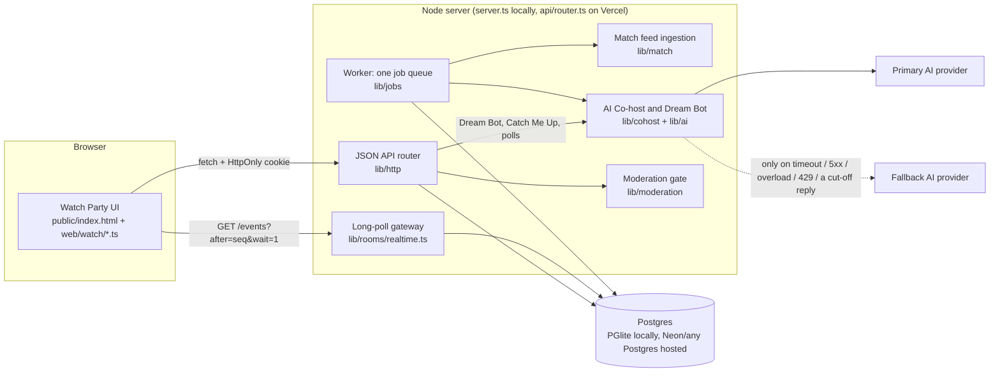
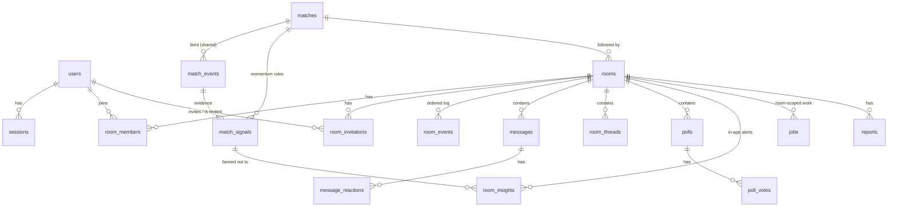

# Huddle Watch Party: architecture

Huddle is a sports Watch Party prototype for IPL T20 cricket, PKL kabaddi, ISL football and NBA basketball: friends (or the public)
chat in a room while a game plays, the room shows verified match data, an AI Co-host in the chat answers questions
nobody answered, flags big moments and catches people up, and Dream Bot answers anyone's own questions privately. It
is one Node.js application written in TypeScript, with one Postgres database. There is no video, no microservice
split, no Redis and no broker.

**Status labels used below:** **Implemented** (built and covered by tests), **Fixture data** (scripted data, not a
live feed), **Planned** (not built).

| Capability | Status |
|---|---|
| Joining (one tap: a guest profile with a username Huddle picks), sessions | Implemented. No name, phone number or password: a 30-day HttpOnly session cookie keeps the browser signed in; new profiles are limited per network |
| Public and private Watch Party rooms, invitations (on the home screen), roles, presence | Implemented |
| Realtime chat, reactions, polls (long-polling) | Implemented |
| Moment threads: #topics for big moments and for what the room argues about | Implemented (deterministic rules) |
| Match Intelligence for four sports: a scoreboard per sport, play by play, status, freshness | Implemented on **fixture data** (real names, made-up games): MI v CSK, Jaipur Pink Panthers v Patna Pirates, Mohun Bagan v East Bengal, Warriors v Lakers; one shared game and public watch party per sport, and every room follows its sport's game |
| Match Centre: full commentary with every play labelled, and graphs per sport (runs per over, score worm) | Implemented, computed from the ingested feed (`?detail=1`) |
| Crowd personas: 200 per sport, chatting in that sport's public watch party only | **Fixture data** (derived on request, never stored, not sent to the AI) |
| Rules and players help: a checked rules sheet and roster per sport; questions answered from the game as it stood when they were asked | Implemented; live answers need an AI key |
| Match Momentum Engine (deterministic rules, dedup, fan-out) | Implemented; alerts show in the room (in-app only) |
| AI Co-host in the chat: unanswered questions, polls on what the room is arguing about, momentum explanations; Catch Me Up | Implemented; live AI needs an API key (provider calls are tested with mocked HTTP) |
| Dream Bot: private Q&A about the room's game | Implemented; live answers need an AI key |
| Primary/fallback AI providers, circuit breaker | Implemented (Anthropic, OpenRouter, Gemini and xAI Grok adapters; OpenRouter and Grok share one chat-completions adapter) |
| Moderation levels, public policy, mandatory baseline, reports, review queue, appeals | Implemented |
| Ephemeral rooms (end, revoke, purge after retention) | Implemented |
| Real sports data providers, account recovery, user blocking, async AI moderation | Planned |

Removed on 3 November 2026: browser push notifications (alert settings, subscriptions, the service worker), private
rooms' own replay with host controls, the `DEMO_CONTROLS` jumps, the seeded demo friends, and `@huddle` mentions in
chat. Migration `013` cleaned up their data (§3).

## 1. System overview



- **One backend.** `server.ts` serves the static UI, the API and runs the worker loop in-process. On Vercel the same
  router runs as one function (`api/router.ts`), and long-poll requests run due jobs while they wait.
- **One database.** Postgres SQL everywhere. Locally the server embeds **PGlite** (Postgres compiled to WebAssembly),
  so `npm start` needs no setup. With `DATABASE_URL` set it uses node-postgres against any Postgres (e.g. Neon).
- **Realtime = long-polling.** Every visible change in a room gets the next per-room sequence number in `room_events`.
  Clients poll `GET /api/rooms/:id/events?after=<seq>&wait=1`; the server answers as soon as something newer exists
  (in-process wake-up locally, a 1-second database check across instances). Each poll re-authorises the caller, so
  leaving, removal and room closure cut the stream off immediately.
- **One job queue** (`jobs` table) for everything slow: AI answers to unanswered questions, quiet-room checks,
  momentum explanations, polls closing, room auto-end and purge. Chat delivery never waits for it. Dream Bot and Catch
  Me Up are requests the asker waits for; they never write to the room.

## 2. Where the data lives

| Data | Where | Retention |
|---|---|---|
| All application data (tables in §3) | Local: `.data/pglite/` (embedded Postgres files, git-ignored). Hosted: the Postgres in `DATABASE_URL` | Per table, §3 |
| Server secret for HMACs | `HUDDLE_SECRET`; locally generated once into `.data/dev-secret` | Until rotated |
| AI provider keys | Server environment only (`ANTHROPIC_API_KEY`, `OPENROUTER_API_KEY`, `GEMINI_API_KEY`, `XAI_API_KEY`). Never in the browser, logs or job payloads | n/a |
| Session | Browser: random token in an `HttpOnly; SameSite=Lax` cookie. Server: only its SHA-256 hash in `sessions` | 30 days |
| Match feed | `match_events` / `match_signals`, shared by every room that follows the match | Kept with the match (fixture data) |
| Data sent to AI providers | Per request only: verified match facts, the sport's rules sheet and roster, the question; for the Co-host's room tasks also a bounded window of this room's messages with members pseudonymised (`member1`…). Dream Bot sends no room chat. Never handles, other rooms or secrets | Subject to each provider's own terms |
| Logs | stdout JSON lines: ids, categories, timings. Message text, questions, tokens and keys are redacted (`lib/log.ts`) | Hosting log retention |
| Hosted database backups | The Postgres provider's backups / point-in-time restore | Follow the provider's window. Huddle's purge does not reach backups, so deletion there is not immediate |

## 3. Database schema

Defined in `lib/db/migrations/001_watch_party.sql` and the numbered migrations after it, applied automatically at
start-up (each once, all pending ones in one transaction, advisory-locked so two instances never race). IDs are
prefixed random strings (`usr_…`, `room_…`, `msg_…`).



### Identity and access
| Table | Purpose | Key columns |
|---|---|---|
| `users` | One row per profile | `handle` (the username: unique, public), `sports` (per sport: the team backed or null, and up to 3 players, migration `010`). Migrations `011` and `012` dropped the old `team`, `picks`, `phone_e164` and `display_name` columns; `013` deleted the seeded demo friends and dropped `is_demo` |
| `sessions` | Server-side sessions | `token_hash` (SHA-256 of the cookie token), `expires_at`, `revoked_at` |

### Match Intelligence (shared across rooms; never per room)
| Table | Purpose | Key columns |
|---|---|---|
| `matches` | One run of a sport's game | `source` = `demo_fixture` (an internal id), `fixture_key` (which sport's script: `mi-csk-demo`, `pkl-jpp-pat`, `isl-mbsg-ebfc`, `nba-gsw-lal-demo`), `status` scheduled/live/completed, `feed_started_at`, `ball_interval_ms` (the pace). Migration `013` dropped `room_id` (private rooms' own runs) and `paused_at`; `backfill_until` is no longer written. Migration `014` closed the retired F1 and ice hockey runs and ended their rooms |
| `match_events` | Timestamped feed events | `provider_event_id` (unique per match: dedupes re-ingestion), `seq`, `kind` ball/event/overend (play/event in the other sports), `data` (bowler, batter, runs, wicket…), `occurred_at`; `backfilled` is no longer written |
| `match_signals` | Momentum Engine output, one per crucial moment | `trigger` (e.g. `wicket_fallen`), `priority` high/medium/low, `evidence` (verified facts), `fact_text` (deterministic sentence), `dedupe_key` (unique), `status` pending/published/suppressed/expired, `ai_text` (optional validated explanation), `expires_at` |

The scoreboard is not stored: each sport's engine (`lib/match/sports/`) recomputes it deterministically from
`match_events` (cricket: runs, wickets, overs, required rate, batting card with each batter's fours and sixes, bowling
card, fall of wickets, partnership; kabaddi: score, half and clock, raid, tackle and all-out points, top raiders and
defenders; football: score, minute, goals, cards and shots; basketball: the score, clock and key stats), and it is cached in memory per match. `lib/match/fixture.ts` lists the four fixtures;
each brings its engine, crowd, discussion topics, rules sheet, roster and example questions. The Match Centre's
labelled commentary and graphs (§4.10) are rebuilt from the same events with the same engines.

### Rooms and membership
| Table | Purpose | Key columns |
|---|---|---|
| `rooms` | Watch parties | `room_type` public/private, `creator_id` (required for private), `match_id` (the sport's shared game the room follows; a private room may have none), `moderation_level` (private only; a CHECK forbids storing one on public rooms), `status` active/ended/purged, `last_seq` (per-room sequence), `ai_enabled` (the AI Co-host and Dream Bot), `ended_at`, `purge_after` |
| `room_members` | Membership and roles | PK `(room_id, user_id)`, `role` owner/admin/member (at most one owner per room, unique index), `status` active/left/removed |
| `room_invitations` | Invitations | `inviter_id`, `invitee_id`, `status` pending/accepted/declined/expired/revoked, `expires_at` (48 h); at most one pending invite per person per room |
| `room_presence` | Who is in the room now | `last_seen_at` (refreshed by polls), `state` active/inactive (tab visible or hidden) |

### Room content: ephemeral
| Table | Purpose | Key columns |
|---|---|---|
| `room_events` | Realtime outbox: what changed, in order | PK `(room_id, seq)`, `type` message/message_update/poll/insight/member/thread/room, `entity_id`. Ids only, no text |
| `messages` | Chat and AI Co-host replies | `sender_type` user/ai (AI messages have no sender and a distinct type so the AI can never trigger itself), `client_msg_id` (idempotency key, unique per sender), `body`, `reply_to_id`, `status` visible/held/removed, `answer_state` (pending → human / ai_claimed → ai_answered / cancelled; `ai_unavailable` only on older rows), `ai_meta` (provider, model, grounding, `asked_at`; never the prompt), `moderation` (decision summary; never a copy of the text), `thread_id` (migration `008`), `match_seq` (the newest play when it was sent, migration `009`) |
| `room_threads` | A #thread inside a room | `slug` (unique per room), `title` (#slug), `about`, `keywords`, `source` moment/discussion, `last_active_at`. Room content: purged with the messages |
| `message_reactions` | Allowlisted emoji reactions | PK `(message_id, user_id, emoji)` |
| `polls`, `poll_votes` | AI or template polls | `idempotency_key` (unique), one open poll per room, `closes_at` |
| `room_insights` | In-app delivery of a match signal to one room | unique `(room_id, signal_id)`: a retry can never show the same alert twice |

When a room ends, every user-facing read of this content stops at once. The purge job deletes all of it
`MESSAGE_RETENTION_HOURS` later (default 24 h) and nulls the room name; a sweep re-queues any purge that was missed.
Dream Bot answers are never stored.

### Limits
| Table | Purpose |
|---|---|
| `user_send_cooldowns` | One row per user: `next_allowed_at`. The chat rule (one message every 10 s, `CHAT_COOLDOWN_SECONDS`) is one atomic `INSERT … ON CONFLICT DO UPDATE … WHERE next_allowed_at <= now()` |
| `rate_events` | Sliding-window counters for new profiles per network, AI requests (per person and per room), Catch Me Up, reactions and search (advisory-locked per bucket). Deleted after 2 h |

### Moderation (minimal audit, no message text)
| Table | Purpose |
|---|---|
| `moderation_events` | Every automated or human decision: categories, severity, `policy_version`, level, action (also `ai_output_blocked` and `bot_question_blocked`, which never count towards a posting pause). Retained 30 days |
| `reports` | Member reports (message or AI response) and appeals; status open/dismissed/actioned |

### Background work and AI observability
| Table | Purpose |
|---|---|
| `jobs` | The one queue: `type`, `room_id`, `dedupe_key` (unique), `payload` (ids and deadlines only), `priority`, `status` queued/running/done/dead/cancelled, `run_at`, `expires_at`, `attempts`/`max_attempts`, `locked_until` |
| `ai_calls` | One row per provider attempt: task (`answer`, `bot`, `momentum`, `catchup`, `poll`), provider, model, outcome, error category, fallback reason, latency, tokens. No prompts or transcripts. Retained 7 days |

### Migration 013 (3 November 2026)
`013_shared_games_only.sql` brings a production database in line with the redesign, in one transaction:
1. Every room on a room-owned run (`matches.room_id` set: a private room's own replay) moves to the newest shared run
   of the same fixture, a scheduled or live one first; with no shared run of that fixture at all, the room follows no
   game. The room-owned runs are marked `completed` (an auto-end still queued for one is ignored, because the room no
   longer follows it), then `matches.room_id` (with its index) and `matches.paused_at` are dropped.
2. `notification_deliveries`, `push_subscriptions` and `notification_prefs` are dropped with their indexes, and any
   queued `push_invite` / `push_delivery` jobs deleted.
3. The demo friends (`users.is_demo`) are deleted after everything that refers to them without `ON DELETE CASCADE`:
   their invitations (as invitee or inviter), poll `requested_by` (set to null), their reports and messages, and any
   private room one of them created (its messages and threads first). Sessions, memberships, presence, reactions,
   votes and cooldowns cascade. Then `users.is_demo` is dropped.

`test/migration.test.ts` builds a database at migration 012 holding all of these cases and upgrades it.

### Migration 014 (3 November 2026)
`014_kabaddi_football.sql` retires Formula 1 and ice hockey (fixtures `f1-monza-demo`, `nhl-edm-tor-demo`): every
active room, public or private, on a run of those fixtures ends as `endRoom` ends one (`end_reason` `sport_retired`,
purge after 24 h, which the sweep picks up; room jobs cancelled, pending invitations expired, presence cleared), their
runs are marked `completed`, and the `f1` and `hockey` keys leave `users.sports`. Its test starts from migration 013.

## 4. Workflows

### 4.1 Joining
1. A new visitor taps Join: `POST /api/auth/guest {}`. The server picks a unique username (`fan_` and four digits,
   one more digit after each clash). Usernames chosen later in Edit profile pass the same strict safety check as other
   public labels, are unique, and reserved names (huddle, admin, moderator…) are refused.
2. The server creates the profile and a session. The browser holds a random token in an HttpOnly, SameSite=Lax
   cookie (`__Host-` prefixed and Secure in production); the database keeps only its SHA-256 hash. Sessions last
   30 days. There is no password, so a profile cannot be recovered after signing out or clearing the browser.
3. New profiles are limited per network (`GUEST_SIGNUPS_PER_IP_PER_HOUR`, default 10), so nobody can mint accounts
   to get around the one-message-every-10-seconds rule. Without `HUDDLE_SECRET` joining fails closed.
4. Platform moderators are listed by account id (`MODERATOR_USER_IDS`). Ids are random and server-generated, so
   nobody can claim moderator rights by choosing a name.

### 4.2 Private room and invitations
`POST /api/rooms` creates the room, makes the caller its owner, records the chosen level (`relaxed`/`balanced`/`strict`)
and invites up to 10 people found through handle search. The room follows the shared game of the sport it was made
for (`match_id`), like that sport's public watch party; nobody can pause or move it. Invitees see the invitation in
their home screen's list (`GET /api/me/invitations`); there are no notifications. Accepting checks that the
invitation belongs to the caller, is still pending, unexpired, the room is active and not full. Owners promote
members to admin; nobody can change their own role.

### 4.3 Sending a message (fast path)
```mermaid
sequenceDiagram
  participant C as Client
  participant API as API
  participant DB as Postgres
  participant O as Other members (long-poll)
  C->>API: POST /rooms/:id/messages {client_msg_id, text}
  API->>DB: session, membership, room active
  API->>DB: same client_msg_id already stored? return it
  API->>API: safety gate (lib/moderation/classifier.ts)
  alt rejected
    API-->>C: 422 + reason (no row, no cooldown used, audit row only)
  else allowed / flagged / held
    API->>DB: BEGIN; 10 s limiter CAS; next room seq; insert message; room_events; follow-up jobs; COMMIT
    API-->>C: 201 message + cooldown_until
    DB-->>O: next poll (or in-process wake-up) returns the event
  end
```
Held messages (uncertain high-risk text) are stored without a sequence number and are visible only to the sender and
moderators until reviewed. AI work is only queued here: no LLM call ever sits on this path.

### 4.4 Match Momentum
1. The worker advances every live match feed once per tick. Due items are inserted into `match_events` (deduped by
   provider event id) inside a per-match row lock.
2. The deterministic rules in `lib/match/momentum.ts` compare the scorecard before and after each item: wickets
   (`partnership_break` when a 30+ stand ends), dropped catches, boundary bursts, dot-ball pressure, a required-rate
   spike, death overs, DRS outcomes and the confirmed result. Thresholds are documented heuristics. The kabaddi,
   football and basketball scripts mark their moments on the items themselves (super tackles, all-outs, do-or-die
   raids, goals, cards, penalties, lead changes, clutch time, the buzzer-beater, the result), and `lib/match/sports/scripted.ts`
   turns them into the same signal rows.
3. Only fresh signals alert. A backlog (server asleep) or several signals in one pass publish at most one alert; the
   rest are stored as `suppressed` for Catch Me Up.
4. A `momentum_signal` job asks the AI Co-host for one explanatory sentence, validates it (schema, cited event ids,
   every number must exist in the verified data, strict safety), and publishes with a compare-and-set. Without AI, the
   deterministic `fact_text` is published on its own.
5. Fan-out: one `room_insights` row per active room following the match → an `insight` event every eligible member
   sees in the room, which the browser shows as an AI Co-host chat message. That is the only delivery path: nothing
   goes to anyone who is not in the room, and nothing is written to `messages`.

### 4.5 AI Co-host answers in the chat
- A question about the room's sport (a question mark or question word, and one of that sport's terms) queues an
  `ai_answer` job with a delay (`UNANSWERED_QUESTION_DELAY_SECONDS`, default 25 s). Mentioning `@huddle` does nothing.
- A human reply (`reply_to`, or an `@handle` mention of the asker) flips the question's `answer_state` from `pending`
  to `human`. The job claims the question with the same compare-and-set (`pending` → `ai_claimed`), so only one path
  can win.
- The job builds the context on the server: verified facts and commentary with timestamps, plus the last 12 messages
  of that room only, pseudonymised and labelled untrusted. It calls the orchestrator, validates the output, then
  publishes in a transaction that requires the room to still be active. An answer that fails validation, or a room
  that ended mid-generation, publishes nothing, and the question is quietly marked `cancelled`.
- Rule and player questions are answered at the moment they were asked. Each message stores `match_seq`, the newest
  play when it was sent; the job rebuilds the game as it stood then (`stateAt`) and sends it as MATCH_WHEN_ASKED,
  with the sport's checked RULES_SHEET and ROSTER. The validator accepts numbers only from the match facts, the rules
  sheet or the roster, so an invented figure is rejected. An answer from the rules sheet carries
  `grounding.status = rules_sheet`, and `ai_meta.asked_at` names the over or game clock it was asked at.
  `GET /api/rooms/:id/guide` shows newcomers the same sheet, roster and example questions.

### 4.6 Dream Bot
`POST /api/rooms/:id/bot {question, client_request_id}` (`lib/cohost/bot.ts`) is the Co-host's Q&A for one person:
1. Membership and room state are checked (`roomAccess`); a room without a game answers `400 no_match`.
2. The per-person AI limit applies (`AI_USER_REQUESTS_PER_5_MIN`, the same bucket as poll suggestions): past it,
   `429` with `retry_after`. A retry with the same `client_request_id` within a minute returns the same reply from a
   room-scoped cache, without another AI call.
3. The question passes the chat's safety gate at the room's level; one the chat would reject or hold is never sent to
   a provider (an audit row `bot_question_blocked`, no text, which never counts towards a posting pause).
4. The context is the latest state of the room's game (the same `matchContext` and `askedContext` builders as the
   chat answers, with the latest play as the moment asked), the recent commentary, the rules sheet and the roster. No
   room chat is sent. The orchestrator runs it as task `bot` with the `answer` schema, and the same validator accepts
   numbers only from that verified data.
5. Room access is checked again before replying (a room that ended meanwhile answers `410`). The reply
   `{ answer, asked_at, grounding, source }` goes to the asker only: nothing is written to `messages` or
   `room_events`. When the AI is not configured, busy, over the room's budget, off in the room, or its answer is
   rejected, the reply is `source: 'unavailable'` with an honest line and the latest verified headline, never a guess.

### 4.7 Catch Me Up
The room's **Catch me up** button asks for `{scope: 'match'}`: the match so far. Coming back to the room asks for
`{since_seq}`: what the person missed. `lib/cohost/catchup.ts` checks membership and room state, then gathers:
- stats straight from the scoreboard (score, rates, top score, best bowling, partnership, boundaries, last wicket; each
  sport has its own);
- the latest key moments and match events;
- the room's talk: up to 60 member messages (pseudonymised) with their #thread and, in a public room, the crowd's lines,
  grouped by thread;
- polls.

The AI writes the headline, key moments, what each busy #thread is saying and the rest of the talk. Validation allows
only the room's real threads, numbers from verified data and safe text; otherwise a deterministic summary from match
data is returned. It goes to the requester only; nothing is written to the chat.

### 4.8 Polls from the room's chat
Every Co-host poll reads what the room is saying: up to 20 recent member messages (pseudonymised, labelled
untrusted) and, in a public room, the crowd's lines on screen. The AI asks about what the room is arguing or excited
about, stays consistent with the verified match data, and falls back to the match situation when the chat gives it
nothing. Without AI, or when its output fails validation, a deterministic template ("Who wins from here?") is used.
- After a big moment (a high or medium momentum signal), each AI-enabled room gets a `debate_poll` job
  `DEBATE_POLL_DELAY_SECONDS` (30) later. It reads the chat since the moment and polls only if the room argued:
  2+ member messages, or 6+ crowd lines in a public room.
- When members start a discussion #thread (3 messages from 2 people on one topic), the same job runs 5 s later.
- Debate polls need someone online and a live game, never cover an open poll, and keep
  `DEBATE_POLL_COOLDOWN_MINUTES` (6) between them.
- Each human message still reschedules a `continuity_check` 3 minutes later: if the room is still quiet, someone is
  online, the match is live and no poll was posted in the last 10 minutes, the Co-host posts one light poll.
- **Suggest a poll** in the room menu does the same on request.

### 4.9 Room end and purge
```mermaid
sequenceDiagram
  participant Owner
  participant API
  participant DB
  Owner->>API: POST /rooms/:id/end (owner; moderators for public rooms; or match finished + 10 min)
  API->>DB: UPDATE rooms SET status='ended' WHERE status='active' (atomic)
  API->>DB: cancel room jobs, expire pending invitations, clear presence, queue purge at +24 h
  API->>API: clear room-scoped AI context cache, wake pollers (they get status 'ended', no history)
  Note over DB: 24 h later
  DB->>DB: room_purge job deletes messages, reactions, polls, insights, threads, room_events; room.status='purged', name=NULL
```

### 4.10 Match Centre (the room's match tabs)
`GET /api/rooms/:id/match` is the scorecard the room screen shows: the sport's scoreboard, freshness, the last 10 plays
and, in public rooms, the crowd's lines. With `?detail=1` (fetched when a match tab is first opened, then on each new
play) `lib/match/centre.ts` replays the
run's ingested events through the sport's engine (fewer than 100 items, so on every request) and adds:
- **Commentary**: every play, newest first (at most 300), each with `over` set. Each engine's `describe` decides it:
  cricket gives a ball its over.ball and symbol (`0`–`6`, `W`, `wd`) and an event the overs bowled; the feed's end of
  an over has no text, so it gets one summed up from that over's deliveries ("End of over 15: 16 runs. CSK 144/2.").
  The other sports give the clock.
- **Graphs**, from each engine's `graphs`: cricket's runs and wickets per over of the feed with the innings total at
  each over's end (the feed starts after 14 overs, so the first over is the 15th; the totals add up to the score);
  kabaddi's, football's and basketball's score at the start, after every change and now.
Cricket's batting card and fall of wickets carry each batter's fours and sixes, counted ball by ball on top of the
fixture's starting card.

### 4.11 One game per sport
Every room follows the shared game of its sport: the public watch party and every private room made for that sport see
one match run (fan-out above), so nobody can pause or move it. A finished game gets a fresh run the next time the
home screen loads, with a new public watch party; private rooms on the finished game close 10 minutes after the
result. Shared games play at `DEMO_SPEED` (0.5x by default): `ball_interval_ms` is set when a run starts, and
`match_rev` includes it, so every member's screen keeps the same pace. Private rooms used to be able to run their own
copy with host controls; migration `013` moved them onto the shared games (§3).

### 4.12 Crowd personas
Public watch parties get a scripted crowd: fixture data, derived rather than stored (a private room holds only the
people invited). Each sport has 200 personas (`lib/match/fans.ts`: seeded handles split between the two sides, such
as JPP and PAT fans for kabaddi); the bootstrap lists them as `crowd_fans`, and the room header counts real people
online and the crowd separately. `GET /api/rooms/:id/match` returns `crowd`, the lines for the plays of the last 45 s,
built by `lib/match/crowd.ts` from each play's crowd cue in the sport's script (or background chatter) with a random
generator seeded by room, run and play. So everyone in a room sees the same fans say the same thing, another room
gets a different crowd, and a faster pace shortens the gaps. Each line carries `at` (play time plus its place in the
burst) and the client shows it then; overdue lines (opening the room late) are skipped. The app does not badge them;
the Match Centre's one note says that the match data and crowd chat in this prototype are illustrative. Lines the
room's moderation level would not allow are dropped, and nothing is written to `messages`, so the crowd never reaches
the message rate limit, reports or retention. The only AI task that sees it is the poll (as untrusted
CROWD_CHAT, section 4.8). Each viewer can hide it on their device.

### 4.13 Moment threads
A room splits its chat into #threads without anyone managing them (`lib/rooms/threads.ts`):
- **Big moments** open one in every room following the match, inside feed ingestion: in cricket a wicket
  (`#dube-out`), the bowling change, the DRS call, a dropped catch, the last over; in kabaddi and football the
  big swings their scripts mark (raids and tackles, goals, cards); in basketball Curry's threes, clutch time and the
  buzzer-beater; and every result. Cricket's are ordinary cricket events, so a real feed
  would open the same threads; the other sports mark them on the scripted items. Re-ingesting opens nothing twice.
- **Discussions** open one when three messages from at least two people in ten minutes argue about the same topic
  of the room's sport (in cricket, Hinglish and English keywords for the DRS call, a dropped catch, the bowling
  change, the last over; in kabaddi, football and basketball each script's own topics, such as the refs and the threes in
  basketball); those messages move into it.
- A message joins the thread it is sent from (`thread_id`), else one whose topic it mentions, else a big moment
  from the last 30 s. Every message still shows in All chat. AI answers stay in their question's thread, and the
  crowd's reactions to a moment carry its thread.
- New threads reach clients as `thread` events; the chips above the chat filter it and show counts.

## 5. Security and privacy controls
- **Authorization on every request**: the user comes from the session; room access is checked in one place
  (`roomAccess`). Private rooms return 404 to non-members, the same answer as a missing room. Room type, roles and
  moderation level are read from the database, never from the request; unknown request fields are rejected.
- **Room isolation**: every query is scoped by room id after the membership check. AI context and caches are keyed by
  room and cleared when the room ends.
- **Prompt injection**: system instructions are server-owned; room text, names, questions and commentary travel as
  labelled JSON data. The model has no tools, so it cannot read other rooms, change settings or act on anyone.
- **Wording**: the system prompt tells the model never to call the game simulated, a demo or a replay, and to say
  plainly that the match data in this prototype is illustrative when asked whether it is real. AI content stays
  labelled as AI ("AI Co-host", "Dream Bot").
- **Input**: text only (multipart and attachments are refused with 415/400), 500-character limit (300 for Dream Bot),
  Unicode normalisation, invisible and bidi characters stripped, rendered with `textContent` only. CSP is
  `script-src 'self'`.
- **Moderation**: the baseline (threats, self-harm encouragement, hate slurs, sexual harassment, personal data) is
  enforced at every level and in every room type, and on Dream Bot questions. Levels only tune profanity, insults and
  spam. Three stopped messages within ten minutes pause posting for two minutes; nobody is banned automatically.
  Members can report, three reports hide a message for human review, and appeals are possible.
- **Secrets** stay in server env vars; logs are redacted; `ai_calls` stores no prompts.
- **Transport and headers**: in production the session cookie is `__Host-` prefixed (Secure, host-only), HSTS is on,
  and the CSP allows scripts, connections and frames from this site only.
- **Room size**: public watch parties hold up to `PUBLIC_ROOM_MAX_MEMBERS` (100); private rooms up to 50 with invites.

## 6. Reliability guarantees (and what is not promised)
- Chat ordering: a concurrency-safe per-room sequence (`UPDATE rooms SET last_seq = last_seq + 1 … RETURNING`).
- Delivery: at-least-once; clients dedupe by sequence and entity id. No exactly-once promise.
- Idempotency: `client_msg_id` for messages, unique `dedupe_key` for jobs and signals, unique `(room_id, signal_id)`
  for insights, a derived key for AI answers, `idempotency_key` for polls, and `client_request_id` for Dream Bot
  (per instance, for a minute).
- Jobs: durable (same transaction as the triggering write), retried with exponential backoff and jitter, dead-lettered
  after `max_attempts`, re-check room and membership when they run, and expire instead of delivering late.
- Measured with `node scripts/load-check.ts` on one laptop (single server, embedded PGlite, 3 rooms × 10 members,
  everyone long-polling): a burst of 30 simultaneous messages reached all 270 recipients with no loss, duplicates or
  reordering, p95 send-to-delivery 0.85 s (the embedded database runs queries one at a time, so bursts queue).
  Messages sent while three 4-second AI calls were in flight arrived in p95 0.27 s, so slow AI work does not hold up
  chat. These are prototype numbers from one machine, measured before the redesign (the script now asks the AI with
  unanswered questions instead of `@huddle`), not capacity claims; nothing was designed for large-scale traffic.

## 7. Known limitations
- Every game is fixture data: a scripted game played as a timestamped feed, not a live provider. The app says so in
  one place, the Match Centre's note. A licensed provider per sport would replace the fixtures in
  `lib/match/sports/`; the kabaddi, football and basketball moments are marked in the scripts, so a real feed for those
  sports would also need momentum rules like cricket's. The rules sheets are short hand-written summaries, not the
  official rulebooks. Cricket's graph and per-over commentary cover the overs of the feed only (from the 15th over).
- Joining is a guest profile without phone verification: one person can hold several profiles (limited per
  network per hour), and a profile cannot be recovered once its browser session is gone.
- Authorization is enforced in application code, not Postgres Row Level Security (one server role connects).
- On serverless hosting, background jobs run while some member is connected (long-poll requests drive them), plus
  a daily Vercel Cron sweep. A dedicated worker process would remove that dependency.
- Circuit-breaker state, the AI concurrency cap and Dream Bot's repeat cache are per server instance.
- Provider calls have per-task timeouts (Dream Bot 6 s within a 14 s deadline, momentum and polls 4.5 s within 10 s),
  so a slow primary leaves the fallback time to answer. A failed call logs `ai.provider_error` with the vendor's
  status and error text (never the key).
- Live AI providers were not exercised end to end in this environment (no API keys); adapters are tested with mocked
  HTTP and the SDK's typed errors.
- Types are checked at compile time only: query results are trusted to match the row types in `lib/db/rows.ts`
  (nothing validates them at runtime), and `any` remains at the edges where data is not modelled (raw request JSON
  before validation, vendor JSON, some per-sport script data).
